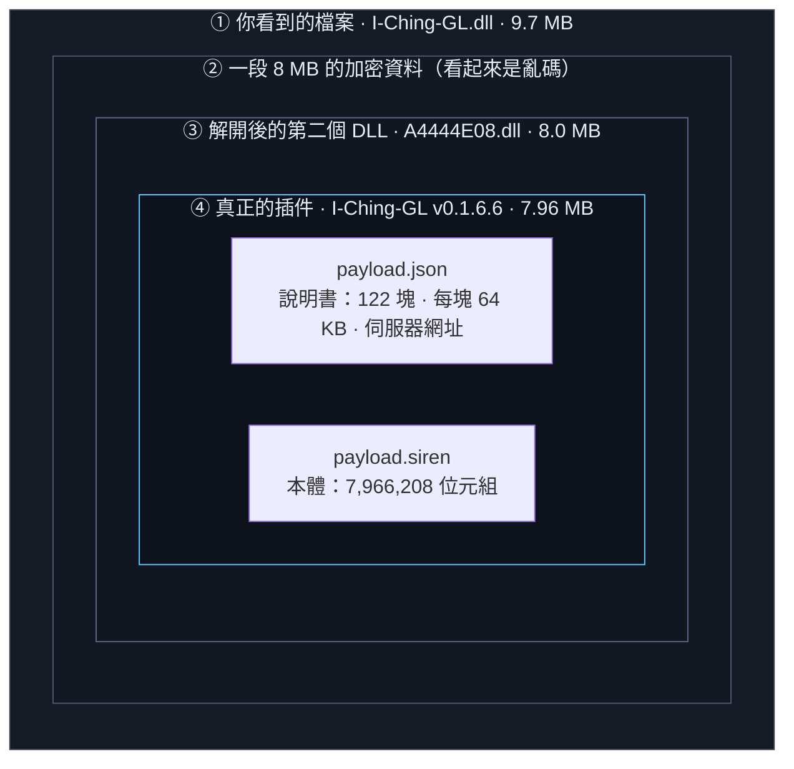
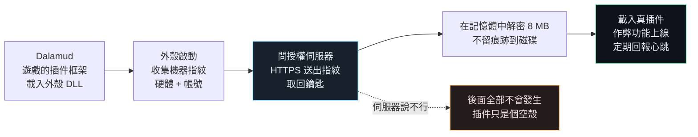
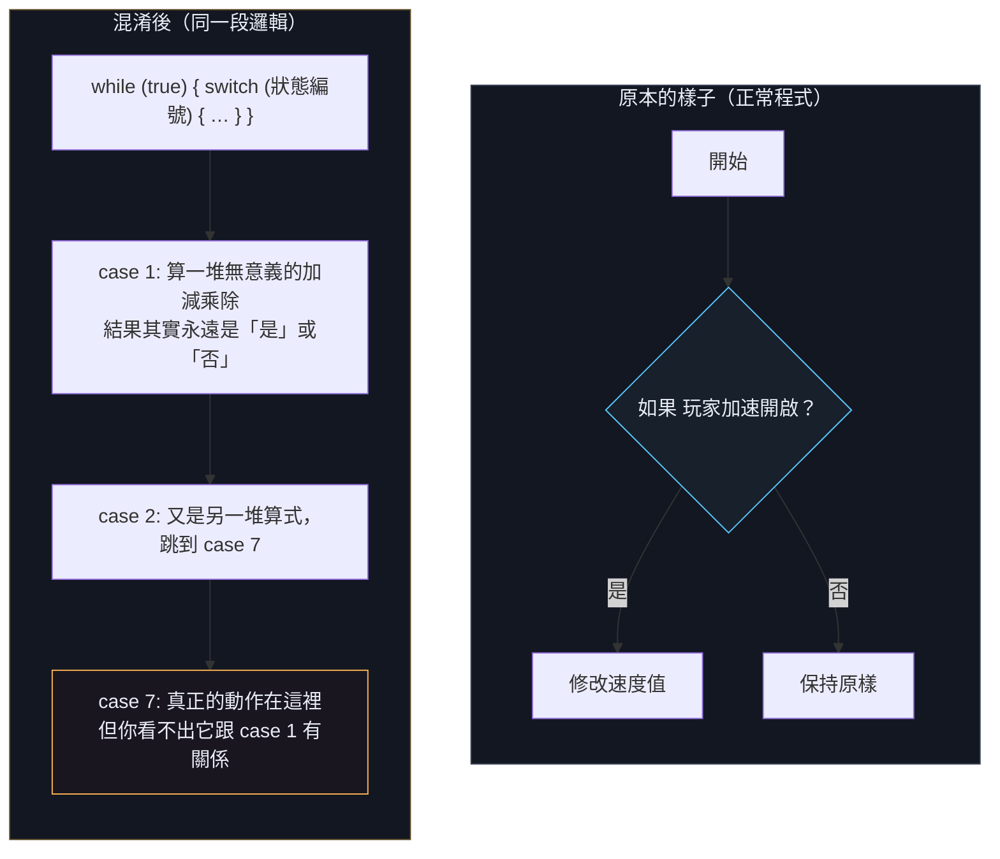
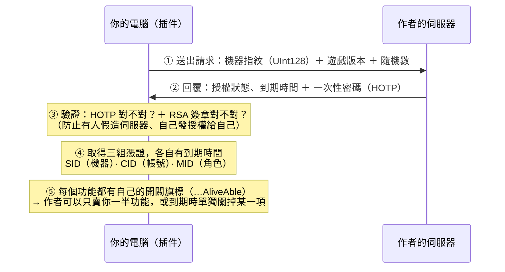

# 圖解：這個插件到底是什麼、怎麼運作

把技術報告翻譯成人話＋圖。完整證據在 [`REPORT.md`](REPORT.md)。

> **一句話：**這是一個 FINAL FANTASY XIV 的作弊外掛。它被包在一層「授權外殼」裡，要連上作者的伺服器取得許可，才會把真正的作弊程式解鎖載入。外殼本身幾乎什麼都不做 —— 它存在的目的只是**保護裡面的東西**和**收費驗證**。

---

## 1. 它像一顆洋蔥：四層包裝

**為什麼要這樣包？** 兩個目的：**防拷貝**（沒有伺服器給的鑰匙就解不開）與**防分析**（靜態打開只看到亂碼）。

## 2. 開機時發生什麼事：五步

**關鍵細節：**解密完全在**記憶體**裡做。磁碟上永遠只有那個加密檔案，所以直接掃描硬碟找不到本體 —— 我們是在遊戲**已經跑起來**之後，從記憶體把它撈出來的。

## 3. 為什麼一開始讀不出來：兩種不同的鎖

| 鎖 | 在哪裡 | 內容 |
| --- | --- | --- |
| **方法體加密** | 外殼 | 998 個方法中有 **488 個**的程式碼是加密的 —— 名字、欄位、結構都留著，但「怎麼做」看不到 |
| **控制流扁平化** | 本體 | 方法都在，但每個都被改寫成一團「猜謎」（見下圖） |

### 什麼是「控制流扁平化」？

正常的程式有清楚的 `if / else`。混淆器把它變成一個 **while + switch** 的大迴圈，並用**永遠算得出答案、但看起來很複雜的算式**決定下一步走哪裡：

**我做的事：**寫了一個工具去**實際計算那些算式**，算出答案後把永遠走不到的分支刪掉，再把剩下的接起來。

| 成果 | 數字 |
| --- | --- |
| 還原成可讀的方法體 | **4,837** |
| 解開的分支 | **87,032** |
| 移除的垃圾指令 | **208,095** |
| 失敗的方法 | **0** |

### 第二道鎖：用「看不見的字元」當名字

插件裡有 2,833 個型別，其中 **2,633 個的名字是用零寬度／雙向控制字元組成的**：

| 型別名稱（實際內容） | 長度 | 你看到的 |
| --- | --- | --- |
| `U+202A U+200E U+200D U+200B U+200E U+200F U+200E U+200E …` | 16 字元 | 空白（完全隱形） |
| `SamplePlugin.Hook.FrontlineRadar` | 32 字元 | 正常可讀 |

在編輯器裡它們像空白行，在程式裡它們是**有效且唯一**的名稱。**這就是為什麼用名字去找會什麼都找不到。**

## 4. 它到底做什麼

| 功能 | 內容 |
| --- | --- |
| **戰鬥與移動自動化** | 加速、防擊退、無視移動限制、防墜落、取消後搖、擴大技能範圍、改施法與冷卻時間 —— 十多個 hook |
| **無視範圍與視線** | 掛掉遊戲「這招打不打得到」的判斷 |
| **雷達 / ESP** | 畫綠色 2 像素線（70% 透明）、24–32 像素職業圖示、狀態圖示、距離判斷、自動選目標 |
| **指令生成器** | 直接對遊戲下 **176 種指令**，含傳送、回城、標記地點、表情、寵物指令（設定裡的 X/Y/Z 座標欄位就是給它用的） |
| **導航外包** | 自己不做尋路，用插件通訊（IPC）**委託給另一個導航插件** —— 所以功能依賴「你另外裝了那個插件」 |
| **背景模糊** | 自己寫了三支顯示卡運算著色器（水平模糊、垂直模糊、透明度修正） |
| **完整介面** | 三套視窗實作、最大的面板 26,536 條指令，還有光暈、點擊漣漪、**下雪**等裝飾 |
| **相容性自檢** | 啟動時掃描遊戲的 **21 個模組**，確認遊戲沒改版到讓功能失效 |

## 5. 它怎麼「碰到」遊戲：不靠名字，靠指紋

因為**不用函式名稱**去找功能，檔案裡就**沒有可搜尋的函式名稱字串** —— 這也是它難分析的原因之一。

| 實測 | 數字 |
| --- | --- |
| 全插件的特徵碼掃描 | **37 處**，分佈在 **19 個類別** |
| 相容性自檢掃描的模組 | **21 個** |
| `GetProcAddress` / `GetModuleHandle` 實際被呼叫 | **0 次**（宣告了但從未使用） |

## 6. 那字串跑哪去了？為什麼檔案裡找不到

> **打個比方：**就像一本食譜只寫「把 A 加 B 煮三分鐘」，但 A 和 B 是什麼寫在另一個保險箱裡。靜態分析看得到「做法」，看不到「材料」—— 材料要等它真的下廚（執行）才會出現。

**順帶一提：**檔案裡有 5 段直接嵌在程式碼中的資料，解出來是：4 個整數、一段 `" \r\n"`、一個特效路徑 `vfx/path/nothing.avfx`，以及一段 **RSA 公開金鑰的開頭**（`SEQUENCE(OID 1.2.840.113549.1.1.1)`）。

## 7. 授權是怎麼運作的

協定細節：請求是 `Pkt_Request`（隨機數、功能碼、插件編號、指紋、身分型別、版本、語言、訊息），回覆是 `Pkt_License_Resp`（狀態、到期時間、指紋、身分型別），內文以 Base64 編碼。

**所以授權不是「能用／不能用」，而是「每個功能各自授權」。**

## 8. 我怎麼把它拆開的

**為什麼要自己寫工具？** 現成的反編譯器看到「扁平化」的程式碼只會給出一團看不懂的 while/switch。所以我寫了一個會「真的去計算那些算式」的工具，把假的分支砍掉，剩下的就變回人看得懂的程式。而且**重複執行結果不變**（可驗證，不是碰運氣）。

## 9. 知道什麼、不知道什麼

| ✅ 已經確認（有證據） | ❌ 拿不到（原理上需要執行時觀察） |
| --- | --- |
| 完整的四層包裝結構與大小 | 伺服器上那把「鑰匙」的內容 |
| 2,833 個型別、10,353 個方法的名字與簽章 | 所有被抹掉的**字串內容**（介面文字、URL、訊息） |
| 十幾個 hook 的功能與掛在哪個遊戲函式 | 37 個**特徵碼本身**（也是執行時算出來的） |
| 雷達的顏色、線寬、圖示大小等全部常數 | 176 個指令的實際參數值 |
| 授權協定的欄位、加密方式（HOTP＋RSA）、狀態機 | HOTP 密鑰與 RSA 公鑰 |
| 三支背景模糊著色器的角色與管線 | 著色器的實際程式碼（在加密資料裡） |

> **界線一句話：**這個插件把「**結構**」完整留在檔案裡，把「**內容**」全部改成執行時才算。所以靜態分析能說它**要什麼、怎麼要**，但要拿到「用什麼去要」，只能在它真的跑起來時看 —— 而執行它，是這次分析從頭到尾都沒做的一件事。

## 10. 附錄：過程中被抓到並更正的錯誤

列出來不是為了自誇，而是讓你知道哪些地方是**驗證過的**，而不是「聽起來合理」。

| # | 原本以為 | 查證後 |
| --- | --- | --- |
| 1 | 分支條件可以在運算元彈出後才讀 | 評估器寫錯了，修正後才正確解析分支 |
| 2 | 只在特定狀態下可達的程式區塊 | 工具漏了它們，**正在誤刪活程式碼**（多刪 113 萬條指令） |
| 3 | 32 位元整數運算 | 用 64 位元算，造成過度刪除（刪除數從 119 萬降到 20 萬） |
| 4 | 某個欄位會回報自我檢查結果給伺服器 | 那個欄位**從來沒被讀寫過** |
| 5 | 版本欄位會提供相容性資訊 | 同樣完全沒有被使用 |
| 6 | 封包是用整塊記憶體複製填的 | 那些線索其實是 async 樣板程式碼，與此無關 |
| 7 | 某兩個欄位有被存取 | 搜尋用「部分比對」，把無關欄位混進來了 |
| 8 | 插件用反射綁定自己的方法 | 那三處反射屬於內附的加密函式庫 |
| 9 | 四個指令方法有在用 | 沒有任何呼叫或引用，最可能是殘留程式碼 |
| 10 | 自檢是檢查插件自己 | 它掃的是**遊戲的 21 個模組**，是另一套機制 |

---

完整技術報告：[`REPORT.md`](REPORT.md)（28 章、約 1,600 行，每項結論都有對應的可重跑指令）。
這份圖解只做翻譯，不新增任何未經證實的說法。
