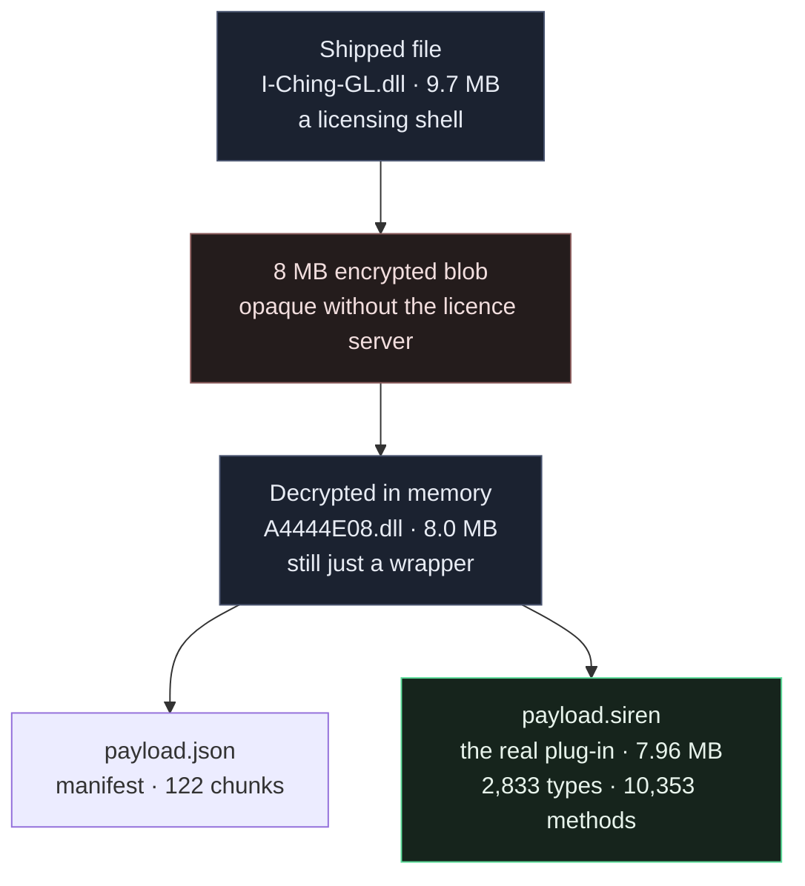

# Reverse-engineering an encrypted, licence-gated .NET plug-in

A reverse-engineering write-up: how a commercial FINAL FANTASY XIV plug-in is packaged,
protected, licensed — and how far a **purely static + memory-forensic** analysis can get
before it hits a wall.

> **Scope and ethics.** The target is used as a **self-study research sample**, and the work is
> **read-only throughout**: nothing was written to it, no code was injected, no licence or
> cryptographic logic was modified, no server response was forged, and the payload was never
> executed. The decrypted payload image was obtained by **read-only memory access**
> (`OpenProcess(PROCESS_VM_READ)` / `VirtualQueryEx` / `ReadProcessMemory`) to a running process
> that was already licensed and unlocked. Nothing in this repository contains the target
> binaries, keys, signature patterns or strings.

---

## The target in one picture

Two different assemblies are both called `I-Ching-GL` — conflating them is the easiest mistake
to make here:

| | **The shell** | **The payload** |
| --- | --- | --- |
| Size | 9,711,616 B | 7,966,208 B |
| Assembly | `SirenAuth.I-Ching-GL` v1.0.0.0 | `I-Ching-GL` v0.1.6.6 |
| Types / methods | 590 / 2,102 | 2,833 / 10,353 |
| Invisible-named types | 555 | **2,633** |
| Method bodies | **encrypted** — 488 of 998 unreadable | flattened, but readable after de-obfuscation |
| Where it lives | the file on disk | inside the blob, unwrapped only at run time |

## Headline findings

| Finding | Evidence |
| --- | --- |
| The shipped file is a **licensing loader**, not the product | one entry type holding a `SirenAuth.Plugin`; the 8 MB blob is only unwrapped after an HTTPS licence round-trip |
| The payload is protected by **control-flow flattening**, not encryption | every method body is an opaque-predicate `while`/`switch`; a purpose-built toolchain recovered **4,837 method bodies, resolved 87,032 branches, removed 208,095 junk instructions, 0 failures** |
| **2,633 of its types are named with zero-width characters** | 2,627 of them generated delegates; a name-based reading sees almost nothing |
| It reaches the game **by signature scan, never by name** | 37 `ScanText` sites across 19 classes; 21 `ScanModule` calls in its compatibility check; `GetProcAddress`/`GetModuleHandle` are declared and **never called** |
| **Every string, pattern and key is built at run time** | the artifact contains the *recipe* and not the *ingredients*: decoding ends in native code reached through a scanned function pointer |
| The licence model is **per-feature, not per-user** | three token sets (machine / account / character), HTTP + Base64 payloads, HOTP verification, RSA signature checks, and an `…AliveAble` gate flag on every feature |
| It is a full cheat, not a toy | combat/movement hooks, range & line-of-sight hooks, a radar/ESP, a **176-flag game-command surface** including teleport, an outsourced navigation client, and three D3D11 compute shaders for background blur |

## Repository contents

| File | What it is |
| --- | --- |
| [`REPORT.md`](REPORT.md) | the full analysis — 28 sections, ~1,600 lines, every claim tied to the command that produced it |
| [`ILLUSTRATED.md`](ILLUSTRATED.md) | the same story in plain language with diagrams (written in Chinese), for readers who don't want the audit trail |

## What is deliberately **not** published

The working analysis produced ~48 trace files, a de-obfuscated copy of the payload, a
decompiled tree, and the capture tooling. None of it is here, on purpose:

* the **de-obfuscated assembly and decompiled sources** are the vendor's code — publishing them
  would redistribute the product;
* the **trace files** contain strings and constants recovered from the binary;
* the **capture tooling** is dual-use;
* the **live licence endpoint** is redacted in `REPORT.md`.

What remains is the part with research value: the method, the measurements, and the boundary.

## How the work was verified

Verification was not a formality — it changed the results:

* **Idempotence as a soundness check.** Re-running the de-obfuscator must change nothing. It
  once removed 1,130,632 *extra* instructions while resolving zero branches — which exposed a
  seeding bug in the state-settling phase that had been deleting live code.
* **Independent re-measurement.** Counts were re-derived with a second tool (REA's managed
  static analysis) rather than trusted from the first pass.
* **Exact matching over convenient matching.** A field-usage audit first used substring
  matching and conflated unrelated fields; re-running it with exact matching changed a
  published table.
* **Ten corrections are documented in the report**, including three tool defects and seven
  inference errors that only fell out when a claim was tested instead of restated. §27.5 lists
  them.

## Reading order

1. [`ILLUSTRATED.md`](ILLUSTRATED.md) — the plain-language version, if you want the story first.
2. `REPORT.md` §1 and §15 — the summary and the container chain.
3. `REPORT.md` §16–§17 — what the payload is, and how its code was made readable.
4. `REPORT.md` §19, §23, §26 — what it does.
5. `REPORT.md` §18, §20, §22 — the protection, and where the missing strings went.
6. `REPORT.md` §21, §25, §27 — the licence layer, the dependencies, the synthesis.

## Licence and attribution

Text and diagrams: released under **CC BY 4.0** — attribution to `kuchris`.
The analyzed artifact belongs to its authors; this repository contains no part of it.
